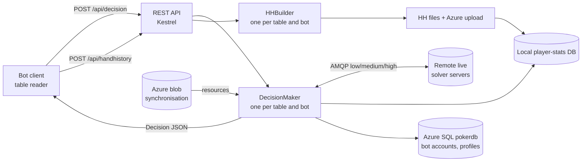

# PDecision | Decision API and hand-history service

> Public portfolio snapshot with a fresh history. Deployment credentials are removed; configuration placeholders require your own services. Binary dependencies and generated PDF guides are omitted.

A Windows desktop service hosting a REST API for poker decisions and hand-history processing. It maintains independent table contexts and uses the strategy libraries in simulator.

## Engineering highlights

- Kestrel hosted inside Windows Forms, JSON contracts, health reporting, and configuration overrides.
- Per-table decision and hand-history state, customer-scoped registration, and history synchronization.
- Regression tooling comparing reconstructed histories with simulator actions across concurrent tables.

**Technology:** C#, .NET 8, Windows Forms, ASP.NET Core, Azure SQL, Blob Storage.

## Platform architecture

```text
PokerBackoffice -> Azure SQL <- ScheduleController (Azure Functions)
                                     | commands / telemetry
                                PokerController
                                     | REST
                                  PDecision
                                     |
                         simulator / DecisionMaking
```

[PokerBackoffice](https://github.com/biresevit/PokerBackoffice) | [ScheduleController](https://github.com/biresevit/ScheduleController) | [PokerController](https://github.com/biresevit/PokerController) | [PDecision](https://github.com/biresevit/PDecision-portfolio) | [simulator](https://github.com/biresevit/simulator-portfolio)

## Setup and operations

A full deployment requires configured infrastructure, platform accounts, and companion components. The following sections describe setup, validation, and operational requirements.

PDecision is the strategy service for the online poker bots. A bot client sends it the current table state, and PDecision replies with the action to take: fold, check, call, bet or raise, the bet size, the street, and the human-like delay it already waited. It also turns the table states into hand histories, which feed the player stats database.

It is a .NET 8 Windows Forms application. The window shows startup status and has a few diagnostic tools. Bots talk to it over a **REST API** (JSON over HTTP) that is hosted inside the app.

The client-facing documentation is the PDF in docs/PDecision_API_Guide.pdf (PDF omitted from this source snapshot), generated by [docs/build_pdf.py](docs/build_pdf.py) (see [Documentation](#documentation)).

## Supported games

| Game | Formats | Preflop | Postflop |
|------|---------|---------|----------|
| NLH  | Ring, SNG, MTT | Solver-generated preflop charts | **Flop, high SPR:** precalculated solver solutions<br>**Flop, low SPR, plus turn and river:** live solver, run remotely (see below) |
| PLO4 | Ring | Solver PLO4 charts | **Flop:** exported solver flop solutions<br>**Turn and river:** rule based |
| PLO5 | Ring | Solver PLO4 charts | **Flop:** exported solver flop solutions<br>**Turn and river:** rule based |

PLO6 table states are accepted and handled as PLO5 (`GetEnumGameType` in [Controller.cs](PDecision/Controller.cs)).

### Game variants

| Variant | Support |
|---|---|
| Antes, straddles | Supported (`HandState.Ante`, `HandState.Straddle`). |
| Run it twice / three times | Supported for strategy and player stats. The hand-history winnings are not exact, because `HandState` describes only one run. Winnings only feed the bot win/loss reports, not strategy or stats. |
| Bomb pots | Work, but the strategy is not tuned for them. |
| Double-board games | Not supported. |

### Tournaments (SNG/MTT)

ICM pressure is calculated from `PlayersLeft`, `NumPlacesPaid` (the payout structure: number of paid places) and the players' `Stacks`. Clients must keep all three up to date in tournament requests, and set `TableType` and `PlayersTotal`. If `NumPlacesPaid` is 0 in a tournament, 20% of the entrants are assumed to be paid.

### Strategy settings per casino (editable while running)

`dbo.CasinoSettings` ([sql/CasinoSettings.sql](sql/CasinoSettings.sql)) is keyed by `(CustomerId, Casino)` and configures solver strategy by customer and casino:

| Column | Meaning |
|---|---|
| `SolverVsHumans` | Use the solver (strong) strategy against humans. Off: the account profiles against every human. |
| `SolverMinBigBlind` | Ring games: the feature is used from this big blind (table currency). `NULL` = every stake. |
| `SolverMinBuyIn` | SNG/MTT: the feature is used from this buy-in (`TournamentBuyIn` of the request). `NULL` = every buy-in. |

When enabled, solver strategy also applies at any stake in hands with a player listed in `dbo.CasinoSettingsPlayer` for `Feature = Solver`. Clients send the tournament buy-in as `TournamentBuyIn` (table currency) in tournament requests; it is not part of HandState and is read from the request. Without it, a set minimum buy-in is not reached. See [PokerBackoffice/docs/casino-settings.md](../PokerBackoffice/docs/casino-settings.md).

Enabling a site through `scheduler.Site` or an active `dbo.CustomerMachine` automatically creates that customer/casino row with every feature Off. Re-enabling preserves edited values. PDecision 41 and later passes the customer ID and casino from machine registration to `CasinoSettings_List`; older clients receive fixed defaults rather than another customer's settings. `CasinoSettings_Upsert` requires `@CustomerId`.

```sql
EXEC dbo.CasinoSettings_Upsert @CustomerId = 3, @Casino = N'BluffPoker', @SolverVsHumans = 1, @SolverMinBuyIn = 20;
EXEC dbo.BotAccount_UpdateStrategy @Casino = N'BluffPoker', @Username = N'bot1', @Strategy = 9;
EXEC dbo.BotWinner_Add @Casino = N'BluffPoker', @Username = N'shark1', @GameType = 0;   -- DBLib EnumGameType: NLH 0, PLO4 1, PLO5 2, Tournament 4
```

Every `Database:RefreshIntervalMinutes` (default 10) PDecision re-reads the casino settings, the bot accounts with their profiles and the known winners (`StatsLoader.RefreshAccountsAndSettings`). Running tables pick up a changed profile within 10 minutes (`DecisionMaker.ProfileReloadMinutes`). If the database can't be read, the values in memory are kept.

## REST API

Default address `http://127.0.0.1:5005`, set in `Api:Urls` (see [Configuration](#configuration)). Implemented in [ApiServer.cs](PDecision/ApiServer.cs), with the request handling in `Controller.GetDecision` and `Controller.AddHandState`.

| Method and path | Body | Reply |
|---|---|---|
| `GET /api/health` | none | `200 {"status":"ready","version":"CONFIGURE_LOCALLY"}`, or `503` with status `initializing` / `failed` |
| `POST /api/decision` | `HandState` JSON | `200` serialized `Decision` |
| `POST /api/handhistory` | `HandState` JSON | `200 {"accepted":true}`, or `{"accepted":false}` when the frame was skipped as inconsistent |

Errors: `400 {"error":"CONFIGURE_LOCALLY"}` for an unusable body (empty, not a `HandState`, empty `TableID` or `OriginalNames[0]`), `401` for a missing or wrong `X-Api-Key` when `Api:ApiKey` is set, `503` while the service is not ready, `500` for unexpected errors.

### Concurrency

- One service handles any number of bots and tables. There is no fixed table limit.
- Per-table state (`DecisionMaker`, `HHBuilder`, previous `HandState`, hand-history writers) is keyed by **`TableID` + `OriginalNames[0]`**. So one bot can play several tables, and several of our bots can share a `TableID`.
- Requests for the same key are serialized with a lock. Decision and hand-history requests have separate locks. Different keys run in parallel.
- A decision includes the human-like wait (`Thread.Sleep` in `Timings.PerformRandomTiming`, up to about 12 s), so each decision runs on its own thread (`TaskCreationOptions.LongRunning`) instead of a thread-pool thread.
- A hand-history request that starts a new hand also writes and uploads the previous hand, so it can take a few seconds.

### Human-like timing

The wait happens inside `MakeDecision`, before the reply is sent. `Decision.RandomTimingMS` is the wait, `DurationMS` the calculation time and `TotalDuration` both. Clients act on the reply immediately and need an HTTP timeout of 30 s or more.

### Legacy named pipes

The old pipe pairs `RequestDM-0..29` / `RequestHH-0..29` (PipesLib, the bot is the pipe server) still work when `Api:EnableNamedPipes` is `true`. They are off by default and are not part of the client documentation. The pipe handlers call the same `GetDecision` / `AddHandState` code.

## Architecture



### Startup (`Controller.Initialize`)

1. Starts the REST API. `/api/health` reports `initializing` from now on.
1. Reads this PC's registration (customer, casino, platform) by MAC address. If the PC is not registered, it stops here with `failed` (see [Machine registration](#machine-registration-casino-and-platform)).
2. Loads the app settings and registers the service with the PokerSuite SQL service (`ServiceInitialisingAsync`).
3. Loads auth data and runs `StatsLoader.Initialize(rootDir: Singleton.DefaultRootDir)`, which:
   - Syncs the strategy resources from the Azure blob container `synchronisation` into `C:/PokerSuite/` (`simulator/DecisionMaking/DB/ResourceSync.cs`). See [Resources](#resources).
   - Creates any missing stats database (`<Casino>_<GameType>.mdf`) with the local LocalDB (`simulator/DecisionMaking/DB/StatsDBCreator.cs`).
   - Loads the flop catalogue (`InitAzure`), the bot accounts and winners from Azure SQL, and the population stats.
4. Starts a heartbeat that runs every 30 seconds.
5. Runs the startup self-tests: blind levels, the game-state DB, hand-history insertion, a PLO4 decision and an NLH decision, all for the casino of this PC's registration. If any test fails, `/api/health` reports `failed` and the service does not accept requests.
6. Starts the legacy pipes if enabled, then switches to `ready`.

### Decision request (`GetDecision`)

- Deserialize and check the `HandState`. Cards are converted to lower case (`"Ts"` → `"ts"`), the format DecisionMaking and the hand evaluators use.
- Look up the `DecisionMaker` for the table and bot, or create one from the hero name, seat count, platform, blinds, game type, straddle and ante. Creating it reads the hero's playing profile from `dbo.BotAccount` in Azure SQL.
- Call `MakeDecision` and return the serialized `Decision`.

### Hand-history request (`AddHandState`)

- Validate the frame on its own and against the previous accepted frame of the same table and bot (stored as the client sent it, before the service's blind adjustments). Frames caught mid-animation are skipped, such as partly dealt flops, missing hole cards or bets that are not set yet, and the reason is logged.
- Update the table's `HHBuilder`.
- When a new hand ID appears, write out the previous hand for the request's casino: local stats DB `<Casino>_<GameType>.mdf`, blob `hand-histories/<Casino>/<handId>.txt` and the Azure HH entry. With several of our bots at a table, each bot's copy is inserted locally, and only the first copy of a hand ID is uploaded.
- If the AI played that hand, also write a normalized-blind copy in the AI format and send it through the table's `DecisionMaker.SendHH`.

### Machine registration (casino and platform)

Customers never send a casino or platform. Each PC running PDecision is registered in Azure SQL, and the registration decides which customer it belongs to and which casino and platform it plays ([sql/CustomerMachines.sql](sql/CustomerMachines.sql)):

| Table | Columns |
|---|---|
| `dbo.Customer` | `CustomerId`, `CustomerName` (unique), `IsActive` |
| `dbo.CustomerMachine` | `MachineId`, `CustomerId`, `MacAddress` (unique, `AA-BB-CC-DD-EE-FF`), `Casino` (EnumCasino name), `Platform` (enPlatform name), `Description`, `IsActive`, `LastSeenUtc` |

At startup ([MachineConfig.cs](PDecision/MachineConfig.cs)) the service collects valid unicast MAC addresses from Ethernet and Wi-Fi adapters, connected or not, and calls `dbo.Machine_GetConfig`, which returns the first active machine of an active customer matching any of them and stamps `LastSeenUtc`. Locally administered addresses (including randomized Wi-Fi addresses) are accepted, consistently with Setup; they still require an exact active database registration. Loopback/tunnel interfaces, empty addresses and multicast addresses are excluded. MAC addresses are registration selectors, not proof of a unique hardware identity. The portfolio snapshot includes the machine adapter policy in `PDecision/Shared/MachineNetworkIdentity.cs`. Run the shared regression cases with `dotnet run --project tests/machine_adapter_policy/MachineAdapterPolicy.Tests.csproj -c Release`.

- Not registered or inactive: the service does not start. The window shows a **PC not registered** dialog ([RegistrationForm.cs](PDecision/RegistrationForm.cs)) with the PC's MAC addresses, a Copy button and the instruction to send them to the administrator and restart PDecision once whitelisted; the status bar shows the same. `/api/health` reports `failed` with the reason and the MAC addresses.
- Unknown casino / platform name in the registration, or the registration can't be read (e.g. the Azure SQL firewall): the service does not start, and the error dialog and `/api/health` show the reason.
- Registered: every table on this PC uses the registered `Casino` (stats DB, bot profiles, hand histories) and `Platform` (PokerSuite calls). `HandState.Platform` from the client is ignored and overwritten, and the self-tests use the same casino.

Registering a customer and a machine:

```sql
EXEC dbo.Customer_Upsert @CustomerName = N'Customer A';
EXEC dbo.Machine_Upsert @CustomerName = N'Customer A', @MacAddress = '00-1A-2B-3C-4D-5E',
     @Casino = 'BluffPoker', @Platform = 'RunYourOwnPokerSite', @Description = N'office PC 1';
```

`Machine_Upsert` accepts `AA-BB-CC-DD-EE-FF`, `AA:BB:CC:DD:EE:FF` and `AABBCCDDEEFF`. Set `IsActive = 0` on the machine or the customer to stop it; this takes effect at the next start of the service. Customers find the MAC with `getmac /v /fo list`.

## Hand histories per customer

Hand histories are private to a customer and shared only between that customer's machines, so every machine of a customer has the same player statistics ([sql/CustomerHandHistory.sql](sql/CustomerHandHistory.sql)).

- **Upload** (`WriteHHToFile.UploadForCustomer`): when a hand is written, it goes to blob `hand-histories/<CustomerId>/<Casino>/<HandId>.txt` and into `dbo.CustomerHandHistory` (unique per customer, site and hand, with the uploading machine). With several of the customer's bots at a table, the first copy is stored and the others are skipped.
- **Download** (`HandHistorySync`, started when the service is ready, then every `HandHistory:DownloadIntervalMinutes`, default 5): lists the customer's hands from its *other* machines after the last downloaded `Id` (kept in `C:/PokerSuite/hhsync_<Casino>.json`), downloads them and adds them to the local stats DB. A new machine first catches up on the customer's whole history.
- **Isolation**: the procedures take the caller's MAC address and resolve the customer on the server, so a machine can only list and check its own customer's hands. The old shared `dbo.HandHistory` table is no longer reachable with `pdecision_client`.
- Internal tools without a machine registration (`CustomerHandHistory.IsConfigured` false) still use the old shared upload.

Blob access requires local storage configuration; this public snapshot contains no storage account key.

## Resources

All local data lives under `Singleton.DefaultRootDir` = `C:/PokerSuite/`.

The resources are kept in the blob container `synchronisation` of the storage account `strategystoragegdr`. Each folder has a marker `<Folder>_synchronisation.json` with a `VersionNumber`, and its content either as loose blobs under `<Folder>/` or as `<Folder>.zip`. `ResourceSync`:

- Skips a folder when the local marker has the same version and `VerifiedComplete: true`.
- Otherwise downloads the loose files (all listing pages, 32 in parallel, missing or different-size files only) or the zip (unpacked into a temp folder, then swapped in).
- Writes the local marker only after every file arrived.
- Unpacks `rules.zip` into `rules/omaha`, because the zip holds that folder's content.

The first start downloads about 6 GB in roughly 1.3 million files (`rules`: 976k files, `omahaFreq`: 3.5 GB) and takes about 30 minutes. Later starts check the 17 markers in about a second.

| Path | Used for |
|------|----------|
| `C:/PokerSuite/<resource folders>` | Strategy resources (`rules`, `omahaFreq`, `holdemOldCharts`, `wizardCharts`, CONFIGURE_LOCALLY) |
| `C:/PokerSuite/db/` | Stats databases, created empty and filled from hand histories |
| `C:/PokerSuite/hh/` | Hand histories. Also the download folder for the Report tool, **which empties it on every download.** |
| `C:/PokerSuite/hhgen/<Casino>/hh/NLH` | Hand histories for the `TestInsertHH` startup test |
| `C:/PokerSuite/Logs/PDecision.log` | Log. Files rotate at 5 MB, 3 archives are kept in `C:/PokerSuite/archives/`. |

## Repository layout

| Path | Purpose |
|------|---------|
| [PDecision/Program.cs](PDecision/Program.cs) | Entry point. Starts `DecisionUI`. |
| [PDecision/MainForm.cs](PDecision/MainForm.cs) | Main window (`DecisionUI`). Starts the `Controller` in the background and shows the initialization status and version. |
| [PDecision/ApiServer.cs](PDecision/ApiServer.cs) | REST API (Kestrel), `Api` settings and service state. |
| [PDecision/Controller.cs](PDecision/Controller.cs) | Service core: startup, self-tests, request handling, per-table `DecisionMaker` and `HHBuilder` instances, hand-history saving, heartbeat, legacy pipes. |
| [PDecision/DisplayHumans.cs](PDecision/DisplayHumans.cs) | "Report" tool. Downloads hand histories from Azure for a casino and start date, then shows hands played and win/loss per player and game type. Bot accounts are excluded. |
| [PDecision/SQLFunctions.cs](PDecision/SQLFunctions.cs) | Placeholder. Everything in it is commented out. |
| `PDecision/images/` | Card images and toolbar icons for the UI. |
| `PDecision/appsettings.json` | API settings, RabbitMQ (CloudAMQP) URI placeholders and the diagnostic level. |
| `PDecision/nlog.config` | NLog file logging settings. |
| [docs/](docs/) | Client documentation: the PDF, its generator script and the profile image. |

The strategy logic does **not** live in this repo. It is in the **`DecisionMaking`** project of the `simulator-portfolio` repo, referenced as `..\..\simulator-portfolio\DecisionMaking\DecisionMaking.csproj`. That project holds `DecisionMaker`, `HHBuilder`, `StatsLoader`, `ResourceSync`, `StatsDBCreator`, `UploadStatistics` and the solver and AMQP clients.

## Dependencies

- **Project reference:** `DecisionMaking` from the `simulator-portfolio` repo, checked out next to this repo.
- **Framework reference:** `Microsoft.AspNetCore.App`, for the REST API.
- **NuGet packages:** `DBLib` 1.0.33, `HandHistoryLib` 1.0.23, `PipesLib`, `PokerSuite.Shared`, `PokerUtil`, `QueryDBLib`, `RulesLib`, `NLog.Extensions.Logging`. Our own packages are built into the local feed `C:\NuGet\Packages`.
- **Runtime services:**
  - Azure SQL `pokerdbserver/pokerdb`: bot accounts and profiles (`dbo.BotAccount`, `dbo.BotWinner`). The PC's public IP must be allowed in the server firewall.
  - Azure blob storage `strategystoragegdr`: resources (`synchronisation`) and hand histories (`hand-histories`).
  - The PokerSuite SQL service, for service registration and heartbeat.
  - SQL Server Express LocalDB, for the local stats databases.
  - The CloudAMQP broker and the remote solver servers.

## Building and running

```text
bot/
├── PDecision/        <- this repo (PDecision.sln)
└── simulator/        <- DecisionMaking, DBLib, HandHistoryLib, CONFIGURE_LOCALLY
```

1. Install the .NET 8 SDK on Windows.
2. Check out the `simulator-portfolio` repo next to this repo.
3. Build with `dotnet build PDecision/PDecision.csproj`. If the private PokerSuite feed answers 401, restore from the local folders instead:
   `dotnet restore PDecision/PDecision.csproj -s C:\NuGet\Packages -s %USERPROFILE%\.nuget\packages`, then build with `--no-restore`.
4. Run `PDecision.exe`. Wait until `GET http://127.0.0.1:5005/api/health` returns `ready`, or the status bar shows `Done initializing DM: Xs`. If a self-test fails, a dialog shows `Error initializing Decision Maker`. Check the log when that happens.

`PDecision.sln` still lists the projects at their old paths inside this repo, so building the `.csproj` directly is the reliable way.

## Tests

[tests/multitable_test.py](tests/multitable_test.py) is an end-to-end test of the REST API and the hand-history pipeline. It needs only Python 3 (standard library).

```text
python tests/multitable_test.py                 # 6 hands per table
python tests/multitable_test.py --hands 15 --seed 7 --keep
```

What it does:

- Starts `PDecision.exe` with `PDECISION_HandHistory__UploadToAzure=false` and a temp `LocalCopyDir`, so no test hands reach the shared pool, and waits for `/api/health`.
- Plays NLH on two 6-max tables (`test-A`, `test-B`) **in parallel**. The same three bots (`BluffBot01`-`03`, which must exist in `dbo.BotAccount`) sit at both tables, with one scripted human each. A small engine in the script deals the cards, runs the betting, and settles showdowns.
- Every bot acts as its own client: after each change it posts its own view (itself as seat 0) to `/api/handhistory`, and when it is to act it asks `/api/decision` and the reply is played.
- Checks every saved hand: one copy per hand and bot, with the right players, action sequence, board and winners, the three copies agree, and no frame was skipped.

Options: `--no-start` uses a running service (it must run with `HandHistory:LocalCopyDir` = `--hh-dir`), `--keep` keeps the saved hands, `--dump-frames DIR` writes every frame sent, for replaying a failing hand. The service logs every skipped frame with its reason (`Skipped frame <table> <bot> hand <id>: <reason>`).

### Simulator run (PokerTable)

The PokerTable simulator (`simulator/PokerTable`) plays PLO/NLH with real strategy decisions from PDecision over REST. Every bot seat asks `/api/decision` when it is to act and posts its own view to `/api/handhistory` after every change, like separate clients at one table. It is the long-running check for errors and for the order of actions in the saved hand histories.

1. Start PDecision for testing (PowerShell):

   ```powershell
   $env:PDECISION_Api__HumanLikeDelays = 'false'
   $env:PDECISION_HandHistory__UploadToAzure = 'false'
   $env:PDECISION_HandHistory__LocalCopyDir = "$env:TEMP\pokertable_rest\hh"
   .\PDecision.exe
   ```

2. Start `PokerTable.exe` (optionally with `POKERTABLE_FAST=1`), then press **Ctrl+B** (all seats bots) and **F5** (run / pause). **Ctrl+F** toggles fast mode (no waiting between moves), **Ctrl+R** switches between PDecision and in-process DecisionMaking. The window title shows the decision, frame and skipped-frame counters. `PDECISION_URL` overrides `http://127.0.0.1:5005`.
3. The simulator writes the true actions of every finished hand to `%TEMP%\pokertable_rest\<table>_expected.jsonl`, and every skipped frame with the bot's previous frame to `<table>_skipped.txt`.
4. Compare the saved hands with what happened: `python tests/check_simulator_hh.py` (newest run; `--expected` / `--hh-dir` to choose).

A 469-hand PLO4 run (3,840 decisions) had no decision errors, no skipped frames and all 2,814 saved copies matching.

## Configuration

`appsettings.json`:

```json
{
  "Api": {
    "Urls": "http://127.0.0.1:5005",
    "ApiKey": "",
    "EnableNamedPipes": false
  },
  "Database": {
    "ConnectionString": "Server=tcp:pokerdbserver.database.windows.net,1433;Initial Catalog=pokerdb;User ID=pdecision_client;Password=<password>;Encrypt=True;CONFIGURE_LOCALLY",
    "RefreshIntervalMinutes": 10
  },
  "HandHistory": {
    "UploadToAzure": true,
    "LocalCopyDir": "",
    "DownloadIntervalMinutes": 5
  },
  "Strategy": {
    "RabbitMQUri": "amqps://<user>:<password>@<host>/<vhost>",
    "RabbitMQUriLive": "amqps://CONFIGURE_LOCALLY",
    "RabbitMQUriTest": "amqps://CONFIGURE_LOCALLY",
    "DiagnosticLevel": 3
  }
}
```

| Setting | Meaning |
|---|---|
| `Database:ConnectionString` | Azure SQL `pokerdb` with the restricted login `pdecision_client` (see [Security](#database-access)). Required. |
| `Database:RefreshIntervalMinutes` | How often casino settings, bot accounts (profiles) and winners are re-read while running. Default `10`, `0` = only at startup. |
| `Api:Urls` | Address the REST API listens on. Use `http://0.0.0.0:5005` to accept other PCs, together with an API key. |
| `Api:ApiKey` | When set, every request except `/api/health` must send it in the `X-Api-Key` header. |
| `Api:EnableNamedPipes` | Also start the legacy named pipes. |
| `Api:HumanLikeDelays` | Default `true`: decisions include a random human-like thinking time. `false` answers at once, for simulations and tests. |
| `HandHistory:UploadToAzure` | Upload saved hands to the shared pool (blob `hand-histories/<casino>/<handId>.txt` plus the Azure HH entry). Default `true`. |
| `HandHistory:DownloadIntervalMinutes` | How often hands of the customer's other machines are downloaded into the local stats DB. Default `5`, `0` turns it off. |
| `HandHistory:LocalCopyDir` | When set, every saved hand is also written to `<dir>/<casino>/<handId>_<hero>.txt`. |

Every setting can be overridden with an environment variable `PDECISION_<Section>__<Key>`, for example `PDECISION_HandHistory__UploadToAzure=false`.

## Documentation

The client guide is generated with ReportLab:

```text
pip install reportlab
python docs/build_pdf.py docs/PDecision_API_Guide.pdf docs/profiles.png
```

It uses the Segoe UI and Consolas fonts from `C:/Windows/Fonts/`. Update the script, not the PDF, when the API changes.

## Security and configuration

This public snapshot contains placeholders rather than deployment credentials. Supply database and broker settings through the documented `PDECISION_` environment overrides. The companion simulator reads `PORTFOLIO_STORAGE_CONNECTION_STRING` for blob access. Do not distribute shared account keys with client software.

## Portfolio validation

Source scanning passed. PDecision and DecisionMaking built successfully using the existing local private package feed. The machine identity policy source is included in this snapshot. Private packages and runtime resources are not bundled.
